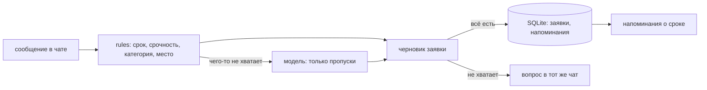

# service-desk-bot — приём заявок в рабочем чате

Сотрудник пишет в чат обычными словами: «В 312 кабинете не печатает принтер, срочно». Бот сам определяет, что случилось, к чему это относится, где находится и к какому сроку нужно починить, заводит заявку, спрашивает только то, чего не хватает, и напоминает о сроке — в тот же чат, откуда пришло сообщение.

Языковая модель здесь — не сердце, а помощник: разбор идёт по правилам, а модель дополняет то, что правила не нашли. Без модели бот работает полностью.

```text
$ desk demo

  Пётр: В 312 кабинете не печатает принтер, срочно
   бот: Заявка №1 принята.
        Что: В 312 кабинете не печатает принтер, срочно
        Категория: техника, срочность: срочно
        Где: кабинет 312
        Срок: 14.09 в 14:30
        Как понял: category — правила, place — правила, priority — правила, title — правила
  Пётр: /my
   бот: Открытые заявки:
        №1 · В 312 кабинете не печатает принтер, срочно · срочно · до 14.09 14:30
 Ольга: Не могу зайти в 1С, пишет «неверный пароль», нужно к завтрашнему утру
   бот: Где это находится — кабинет, этаж или адрес?
 Ольга: на складе
   бот: Заявка №2 принята.
        Что: Не могу зайти в 1С, пишет «неверный пароль», нужно к завтрашнему утру
        Категория: программы, срочность: обычная
        Где: склад
        Срок: 14.09 в 18:39
        Как понял: category — правила, deadline — правила, place — ответ, title — правила
Мастер: /take 1
   бот: Заявка №1 в работе у Мастер. Срок — 14.09 14:30.
Мастер: /done 1
   бот: Заявка №1 закрыта. Напоминания по ней сняты.
   бот: ⏳ Заявка №2 ещё не закрыта: «Не могу зайти в 1С…». Срок — 14.09 в 18:39.
```

Демо идёт через тот же код, что и рабочий бот, но вместо Telegram — эмулятор, а вместо модели — правила. Ни токена, ни сети, ни нейросети для показа не нужно.

## Что умеет

| Возможность | Подробности |
|---|---|
| Понимает свободный текст | категория (техника, программы, доступы, сеть, хозяйственное), срочность, место, срок, телефон |
| Спрашивает недостающее | по одному вопросу за раз, ответ подставляется именно в то поле, о котором спросили |
| Показывает, откуда что взял | «category — правила, place — модель, title — ответ»: видно, чему верить |
| Считает срок | раньшее из двух: названный человеком срок и норматив реакции по срочности (1 ч / 4 ч / 8 ч / 3 дня) |
| Напоминает | на половине срока и в момент срока; закрытая заявка напоминания снимает |
| Команды | `/my`, `/take 12`, `/done 12`, `/cancel`, `/help` |

## Как запустить

```bash
uv sync
uv run desk demo                      # разговор на готовом сценарии, без сети и без модели
uv run desk tickets --db заявки.sqlite
cp .env.example .env                  # положите туда токен от @BotFather
uv run desk run                       # бот слушает Telegram
```

| Переменная окружения | Зачем |
|---|---|
| `DESK_BOT_TOKEN` | токен бота; читается только из окружения и никуда не печатается |
| `DESK_DB` | файл с заявками (по умолчанию `заявки.sqlite`) |
| `DESK_TZ` | часовой пояс офиса, в нём считаются сроки (по умолчанию `Europe/Moscow`) |
| `DESK_MODEL` | `none` (по умолчанию), `ollama` или `openai` |
| `DESK_MODEL_NAME`, `DESK_MODEL_URL`, `DESK_MODEL_KEY` | какая модель, где она и ключ (ключ — только для `openai`) |

## Как устроено



| Модуль | Ответственность |
|---|---|
| `rules.py` | разбор текста без модели: «через 2 часа», «завтра к 15:00», «до пятницы», «каб. 312», «срочно» |
| `llm.py` | модель как деталь: Ollama или OpenAI-совместимый сервис, разбор ответа и одна попытка починки |
| `extract.py` | правила плюс модель: модель заполняет только пустые поля, срок из правил не переписывается |
| `models.py` | заявка, черновик, нормативы реакции |
| `storage.py` | SQLite: заявки, незаконченные разговоры, напоминания, обработанные обновления |
| `telegram.py` | Bot API: длинный опрос, повторы, смещение в базе |
| `bot.py` | разговор и команды |
| `scheduler.py` | напоминания в общем цикле, без отдельного потока |
| `testing.py` | эмулятор Telegram и модели-заглушки для тестов |

## Как проверялось

- `ruff format`, `ruff check` (E, F, W, I, B, UP, S — bandit, C4, SIM, PT, RUF, DTZ, ASYNC) и `mypy --strict` — без замечаний.
- `pytest` — 74 теста за 1,2 с:
  - правила: 10 вариантов сроков, категории, срочность (в том числе «не срочно» против «срочно»), места, телефоны, заголовок без приветствия;
  - модель: JSON в любой обёртке, починка после мусорного ответа, отказ после второй неудачи, форма запросов к Ollama и к OpenAI-совместимому API, ошибки сети и статусы;
  - объединение: модель заполняет только пропуски, не переписывает найденный срок, выдуманная категория отбрасывается, срок «через два года» отбрасывается;
  - хранилище: заявки, смена статуса, снятие напоминаний, незаконченный разговор, повторные обновления;
  - Telegram: разбор обновлений, повтор при 429 и 503, отказ при неизвестном методе;
  - разговор: заявка с одного сообщения, уточнение места, команды, повтор обновления, ответы в нужный чат;
  - напоминания и командная строка: напоминание уходит один раз, закрытая заявка молчит, демо, список заявок, запуск без токена.
- Живой прогон 12.09.2026 с локальной моделью `qwen3:4b` (Ollama, 8 фраз): модель дополнила 7 полей, которые правила не нашли (категория «хозяйственное» для «течёт батарея», место «склад» из «на общий ящик склада», срочность), ни одного сбоя разбора JSON. Одна ошибка модели: из «Кондиционер в 415 гудит» она вернула место «кабинет» без номера. На этой машине один запрос к 4B-модели занимает около 50 с — поэтому правила идут первыми, а модель спрашивают только про пропуски.

### Не проверялось

- В настоящем Telegram бот не запускался: токена у меня нет, а чужой я не возьму. Клиент проверен на эмуляторе, который повторяет форму ответов Bot API (`getUpdates`, `sendMessage`, коды 429 и 503).
- Долгая работа: перезапуски, потеря связи на часы, тысячи заявок в базе — не проверялись.
- Качество модели измерено на восьми фразах одной модели. Это проверка работоспособности, а не оценка точности.
- Переход на летнее время и смена часового пояса офиса не проверялись.
- Нет разграничения прав: закрыть заявку может любой участник чата.

## Структура

```text
src/desk/   rules, llm, extract, models, storage, telegram, bot, scheduler, testing, demo, cli
tests/      rules, llm, extract, storage, telegram, bot, scheduler+cli
```
